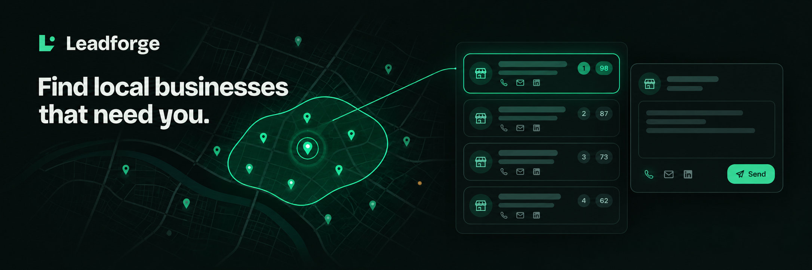
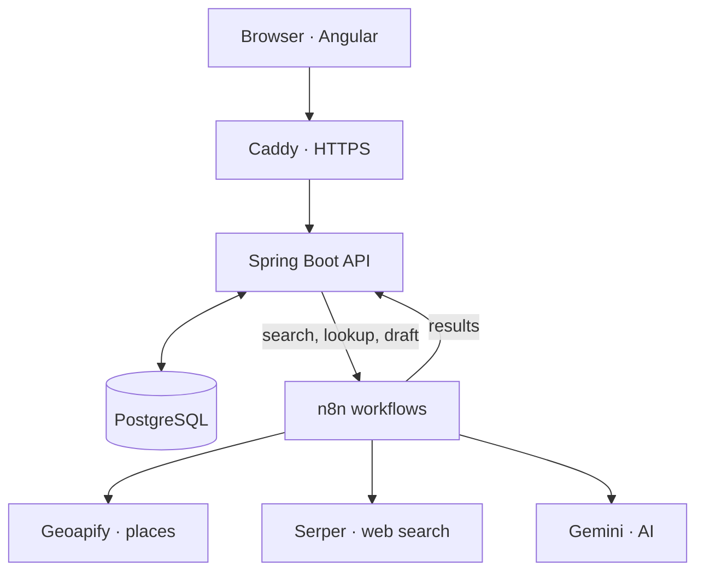

<p align="center">
  
</p>

<p align="center">
  <strong>Find local businesses that need your services, see why they fit, and send the first message.</strong>
</p>

<p align="center">
  
  
  
  
  
  
</p>

---

**Leadforge** is for freelancers: designers, developers, photographers, marketers. Describe what you offer, pick a
city or draw an area on the map, and Leadforge lists the businesses there, scores how well each one fits and how
reachable it is, and drafts a first message in **English, French or Arabic**, for **email or WhatsApp**. You read and
correct every draft before sending it.

## ✨ Features

| Feature | What it does |
|---|---|
| 🗺️ **Search by city or area** | Up to 3 cities at once, or a rectangle drawn on an OpenStreetMap map. |
| 🎯 **Fit score with reasons** | 1 to 10 from rules in code (business type, website, online booking, contacts found), so every score is explained. Unreachable businesses are capped at 3. |
| 🔎 **Contact lookup** | Finds a missing website, phone, email or social page, and keeps it only when it clearly belongs to the business. |
| ✍️ **Message drafts** | Written by AI from the facts found, never invented, in your language and channel. |
| 📋 **Lead tracking** | Every lead across all searches, with statuses, filters and an Excel export. A business found twice is kept once. |
| 🔔 **Telegram reminders** | A nudge 3 days and a week after a lead was contacted without a reply. |
| 🧪 **Demo and guest access** | Try it with one click, within daily limits. An admin area shows accounts, usage and AI costs. |

## ⚙️ How it works



The browser only talks to the API. Searches, contact lookups and drafts run in three n8n workflows, which call the
outside services. API keys stay in n8n's encrypted credentials, never in the code.

## 🚀 Run it

| Where | Guide |
|---|---|
| **On your machine** | [app/README.md](app/README.md): Docker for the databases and n8n, then the backend and the frontend |
| **Free hosting** | [app/deploy/hf/FREE-HOSTING.md](app/deploy/hf/FREE-HOSTING.md): one Hugging Face Space, Supabase databases, no bank card |
| **Your own server** | [app/deploy/DEPLOY.md](app/deploy/DEPLOY.md): Docker Compose, Caddy with HTTPS, nightly backups |

## 📁 Repository

```
app/
├── frontend/    Angular web app
├── backend/     Spring Boot API, Flyway migrations
├── n8n/         the three workflows (find leads, contact lookup, draft message)
├── deploy/      free hosting and server deployment
└── tools/       workflow deploy, credentials, benchmarks
```

## 📌 Status

Public beta. The source is public while the beta runs; no license is granted to reuse it.
